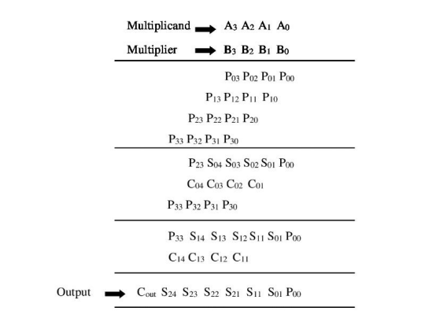
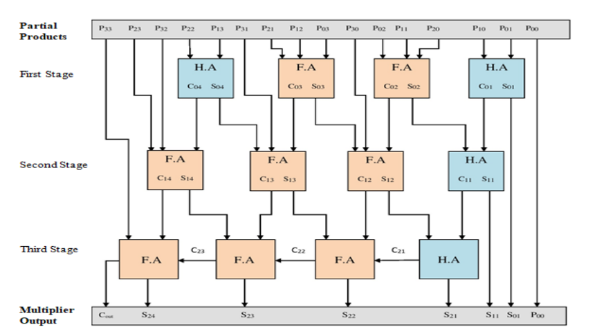
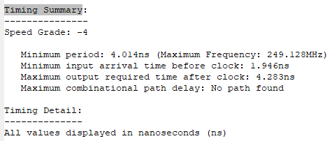
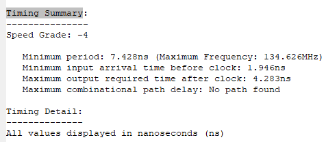
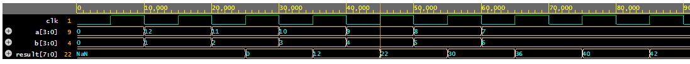

# Pipelined vs. Unpipelined Wallace Tree Multiplier
A 4-bit Wallace Tree Multiplier in Verilog, optimized with a 3-stage pipeline for an 85% throughput improvement on FPGA.

## Project Overview
This project presents a structural implementation of a **4x4 Wallace Tree Multiplier** in Verilog, designed to explore microarchitectural trade-offs. The project compares a baseline unpipelined (combinational) design against a **3-stage pipelined** architecture. 

By conducting FPGA synthesis and Post-Place & Route (PAR) analysis in Xilinx ISE, this study successfully demonstrates how pipelining can drastically increase throughput by breaking long combinational critical paths.

## Research Methodology
This project follows a rigorous academic research methodology:
1. **Baseline Replication:** The structural architecture (Half/Full Adder reduction) was replicated from the published research paper *"Design and Verification of 4 X 4 Wallace Tree Multiplier"* (Esa & Achyut).
2. **Design Space Exploration (DSE):** To address the critical path limitations of the baseline unpipelined design, a 3-stage pipeline was proposed and implemented. 
3. **Post-Synthesis Analysis:** Both designs were synthesized and physically routed on a Spartan-3E FPGA. The results were analyzed to quantify the architectural trade-off between added register area and maximum operating frequency.

## Architecture & Theory
A Wallace Tree Multiplier reduces partial products in parallel using Carry-Save Adders (Half Adders and Full Adders), minimizing propagation delay compared to standard array multipliers.

### Theoretical Reduction (Partial Products)
The diagram below illustrates the 16 partial products (\(P_{00}\) to \(P_{33}\)) and the 3-stage reduction process to compute the final 8-bit product.

### Structural Hardware Architecture
The hardware is composed of structural Half Adders (HA) and Full Adders (FA). Pipeline registers are inserted after each reduction stage to isolate the logic and shorten the critical path.

## Synthesis Results (Post-Place & Route)
Both designs were synthesized and routed targeting a **Spartan-3E FPGA (xc3s500e, -4 speed grade)**. The Post-PAR timing analysis (which includes real physical wire delays) proves the architectural efficiency of the pipeline.

| Metric | Unpipelined (Baseline) | Pipelined (3-Stage) | Improvement |
| :--- | :--- | :--- | :--- |
| **Critical Path Delay** | 7.428 ns | **4.014 ns** | **46% Faster** |
| **Max Frequency** | 134.62 MHz | **249.12 MHz** | **+85.05% Throughput** |
| **LUTs Used** | 36 | 35 | No Logic Overhead |
| **Flip-Flops Used** | 16 | 37 | +21 Pipeline Registers |

### ISE Timing Reports
*(Proof of Post-PAR Timing Summaries)*

## Simulation & Verification
The designs were simulated using **EDA Playground (Icarus Verilog)**. The testbench validates the pipelined logic by feeding continuous data every clock cycle, verifying the expected 3-cycle latency and 1-result-per-cycle throughput after the pipeline fills.

*(Waveform showing the staircase output sequence of valid multiplication results)*

## Repository Structure
*   `/src`: Contains the Verilog source files (`half_adder.v`, `full_adder.v`, `pipelined_wallace_tree.v`, `unpipelined_wallace_tree_multiplier.v`).
*   `/tb`: Contains the testbenches for simulation.
*   `/docs`: Contains all block diagrams, waveform screenshots, and synthesis timing reports.
*   `ANALYSIS.md`: A detailed breakdown of the raw synthesis data and throughput calculations.

## How to Run
1. Clone the repository.
2. **For Simulation:** Import the `src` and `tb` files into EDA Playground or ModelSim.
3. **For Synthesis:** Open Xilinx ISE, set either the pipelined or unpipelined module as the Top Module, and run the `Implement Design` flow to generate timing reports.

## Author
**Ali Abdullah**  
*Bachelor of Electrical Engineering (Electronics)*  
[LinkedIn](https://linkedin.com/in/aliabdullahshk) | [GitHub](https://github.com/AliAbdullahshaikh)
